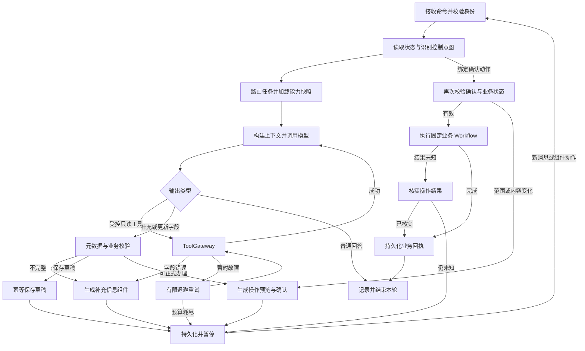

# 01 工程架构与 Agent 状态机

## 1. 技术决策与范围

采用 Java 21、Spring Boot、Maven 多模块、PostgreSQL，前端采用 React + TypeScript + Vite。浏览器通过同源反向代理访问后端，避免为首版额外引入跨域认证复杂度。前端框架是本轮设计选择，尚未初始化工程。

LangChain4j 负责模型与工具协议，LangGraph4j 是唯一编排引擎；不再叠加 AI Services 自动工具循环作为另一套执行器。优先使用低层模型/ToolSpecification 适配，自定义可观测的图节点。官方 Agent Executor 的设计用于参考，只有验证拦截、检查点与确认机制满足要求时才复用具体实现。

Qwen 首版优先百炼 OpenAI 兼容协议，通过 LangChain4j 对应适配器接入；base URL、model、API Key 外置，默认模型候选 qwen-plus。具体模型可用性、地域和流式工具调用组合在开工时验证。API Key 仅服务端持有，不通过前端配置页录入或返回。

首版以单 JVM + 数据库持久队列运行，不引入 Redis、Kafka、独立调度集群或完整低代码设计器。保留未来多实例的租约与并发约束。

## 2. 工程结构与依赖

```text
backend/
  pom.xml
  assistant-domain/          任务、确认、操作、字段、错误码等纯 Java 模型
  assistant-application/     用例、权限策略、端口接口、恢复协调
  assistant-agent/           LangGraph4j 图、LangChain4j 适配、Skill、上下文
  assistant-infrastructure/  JDBC、Checkpoint 适配、模型客户端、队列、时钟
  assistant-business-mock/   模拟低代码底座、员工资料、证照、审批接口实现
  assistant-boot/            HTTP、认证、SSE、组装、启动配置
frontend/                   工作台、卡片、任务详情与开发追踪视图
capabilities/               项目业务能力配置，非 Codex 开发技能安装目录
  passport-borrow/1.0.0/     manifest.yaml、instructions.md、workflow.json
  todo-review/1.0.0/
prompts/                    版本化系统、路由、抽取、摘要模板
deploy/                     本地数据库及后续 RAG 服务配置
docs/                       需求、设计、契约、验收与技术验证记录
```

依赖方向：application → domain；agent → application/domain；infrastructure → application/domain；business-mock → application/domain；boot 组装全部模块。domain 不依赖 Spring/模型库；application 只定义 GraphRunner、ModelGateway、BusinessGateway、Repository、TraceSink 等端口，不反向依赖实现。

每个模块内按具体能力分包，避免把所有实现都堆在一个 service 目录。

## 3. 核心接口职责

| 内部接口 | 输入与输出 | 约束 |
| --- | --- | --- |
| IdentityResolver | 认证 session → CurrentActor | 身份永不从模型或请求 userId 取值 |
| ConversationService | 消息/交互 → 持久化命令和 runId | clientMessageId/actionId 去重 |
| TaskCoordinator | 命令 + 当前状态 → 任务/运行 | 控制任务恢复和单会话写入串行 |
| GraphRunner | taskId + runId → 节点事件 | 只用 LangGraph4j 推进 |
| SkillRegistry | intent + 身份授权 → 固定版本能力快照 | 先目录后正文；工具按需暴露 |
| ContextAssembler | 固定规则 + 任务 + 摘要 + 最近消息 → 模型请求 | 权限与确认事实只能由服务端提供 |
| ToolGateway | 工具名 + 参数 + ExecutionContext → ToolResult | Schema、权限、确认、重试和日志集中处理 |
| BusinessGateway | 业务请求 → 结构化业务响应 | mock/real 使用同一契约 |
| ConfirmationService | 已校验业务预览 → confirmationId | 保存实际范围、版本与请求摘要 |
| OperationService | 已授权命令 → 操作状态/回执 | 幂等、结果核实、恢复 |

ExecutionContext 包含服务端 actor、taskId、runId、operationId、deadline、能力版本及确认引用。此对象不属于模型可填写参数。

## 4. Agent 图



模型只能提出操作建议，不能自行制造确认。正式提交和审核在确定性的 Workflow 节点执行，通过同一 ToolGateway 留痕；不向模型暴露可绕过确认的裸写入接口。工具白名单和服务端规则双重约束。

图节点是本项目设计名称，不代表框架同名 API。中断/恢复适配通过技术验证后实现；不能复制 Python LangGraph 的 interrupt 调用当作 Java API。

## 5. 状态与恢复

| task.status | 含义 | 允许的后续行为 |
| --- | --- | --- |
| RUNNING | 解释、查询、校验 | 等待输入/确认/执行/完成/失败 |
| WAITING_INPUT | 缺字段或需消歧 | 补充、保存草稿、暂停、取消 |
| DRAFT_SAVED | 已明确保存草稿 | 恢复填写或取消任务，草稿仍独立保留 |
| PAUSED | 用户主动暂停 | 恢复、取消 |
| WAITING_CONFIRMATION | 预览已生成 | 确认、修改范围/字段、保存草稿、取消 |
| EXECUTING | 已授权写入进行中 | 回执或结果核实；不能重放新操作 |
| RECONCILING | 写入可能成功，需核实 | 查结果、继续核实或标记需人工核实 |
| SUCCEEDED | 本次任务目标已达成 | 读取历史；新需求建立新任务 |
| PARTIAL_SUCCEEDED | 批量部分成功 | 读取结果或恢复可重试失败项 |
| FAILED_RECOVERABLE | 预算耗尽等可恢复故障 | 显式恢复并重新检查状态 |
| FAILED_FINAL | 不支持或无法办理 | 查看错误、建立修正后的新任务 |
| CANCELLED | 当前任务停止推进 | 查看历史，草稿不自动删除 |

Agent 任务完成与审批流程完成独立：申请提交成功即可结束该任务，业务流程仍为 IN_APPROVAL。

一次用户输入形成一个 run；run 状态为 QUEUED/RUNNING/WAITING/COMPLETED/FAILED/CANCELLED。任务可跨多个 run。网络重试不是新 run，用户补充资料后是新 run。

图线程标识使用服务端生成的用户作用域 taskId，不能只用 conversationId。检查点存储结构版本和能力版本；旧任务固定版本继续执行。必须升级的元数据需要迁移校验并使旧确认失效。

默认每会话一个推进中的写入任务。用户插问政策或查询进度时可以执行只读旁路，保留原任务；新写入意图出现时提示切换，保存并暂停前任务。没有明确 taskId 且“继续”对应多个任务时返回任务选择组件。

## 6. 字段与上下文

字段保存 value、source（PROFILE/METADATA_DEFAULT/USER/DERIVED）、sourceRef、updatedAt、editable、validationStatus。用户纠正只影响可编辑业务字段，不能改执行身份。日期派生值保存原文、参考时间和时区；金额使用十进制字符串和币种，不交给模型自行累计统计。

上下文顺序：固定系统约束 → 能力/工具与版本 → 当前结构化任务 → 已确认事实和执行结果 → 历史摘要 → 最近完整消息 → 当前用户输入。外部文档、工具文本和用户文本作为数据，不能覆盖系统规则。

默认最近 12 条完整消息；估算输入达到配置预算的 70% 时摘要旧消息。工具请求与结果成对保留，不能从中间截断。摘要只存偏好、任务缘由等对话信息；身份、字段、操作状态以结构化数据库事实为准。原始消息不删除，摘要保存覆盖范围、模板和模型版本。

摘要失败时使用已验证的结构化任务摘要并减少旧消息；仍超预算则暂停并提示缩小任务，不静默丢失待确认内容。

流式模型输出先以临时消息展示，完整响应后才标记 final。工具参数必须拼接完成且通过 JSON/Schema 校验后执行。流中断时不执行不完整工具请求；若已输出文字后需要重试，发 message.reset 并使用新 messageId/attempt，避免拼接两次回答。

## 7. 能力与 Prompt 生命周期

能力清单至少有 skillId、version、description、intents、workflowId/version、metadataTypes、allowedTools、promptVersion、inputSchemaRef、outputSchemaRef、timeoutPolicyRef、checksum。

发布过程：接口契约检查 → 工具绑定及参数验证 → Skill 草稿 → 明确字段/规则/确认点 → 本地验收 → 发布不可变版本。V0.1 两项能力在仓库中人工维护，V0.2 增加生成与发布校验，不把自动生成文案直接作为可信业务规则。

加载路径来自已注册目录，模型只选择合法 skillId，不能指定文件路径。首次任务保存版本快照；切换任务卸载前一能力工具；保留中的版本不得物理删除。模型请求日志记录能力哈希，避免反复保存全部正文。

## 8. 本地启动与版本验证

设计端口：前端 5173、后端 8080、PostgreSQL 5432。必需配置为数据库连接、QWEN_API_KEY、QWEN_BASE_URL、QWEN_MODEL；RAG 服务在对应版本另启。

启动状态区分数据库可用、配置有效、模型验证通过。无 Key 时返回配置提示；仅自动化验收可显式启用确定性测试模型，不能在演示中悄悄回退假模型。

依赖锁定前验证四项：流式文本和完整工具参数；连续多轮工具协议；Checkpoint 跨 JVM 重启恢复；确认前中断、确认后恢复且不重复写入。具体 Maven 版本与 API 以验证记录为准。

## 9. 已查阅的官方参考

- [LangGraph4j Agent Executor](https://github.com/langgraph4j/langgraph4j/blob/main/langchain4j/langchain4j-agent/README.md)：工具循环及能力注入参考。
- [LangGraph4j 人工介入示例](https://github.com/langgraph4j/langgraph4j-examples/tree/main/reference/agent-q%26a)：中断与恢复示例；其 README 明示模型推理是模拟的，不能当作真实 Qwen 集成成品。
- [PostgreSQL Saver](https://github.com/langgraph4j/langgraph4j/blob/main/langgraph4j-postgres-saver/README.md)：持久检查点参考，具体适配以版本验证为准。
- [LangChain4j 工具说明](https://docs.langchain4j.dev/tutorials/tools/)：低层工具声明与执行协议参考。
- [百炼流式输出](https://help.aliyun.com/zh/model-studio/stream)：Qwen 接入协议参考。
